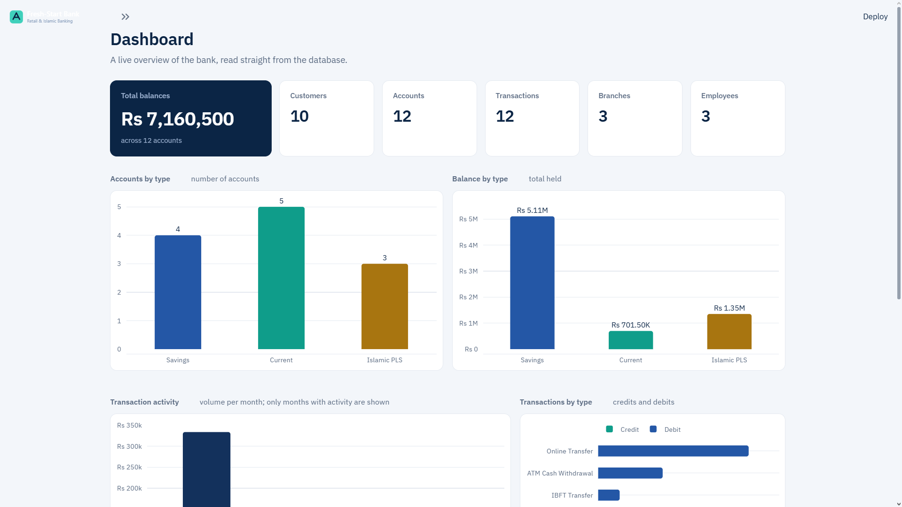
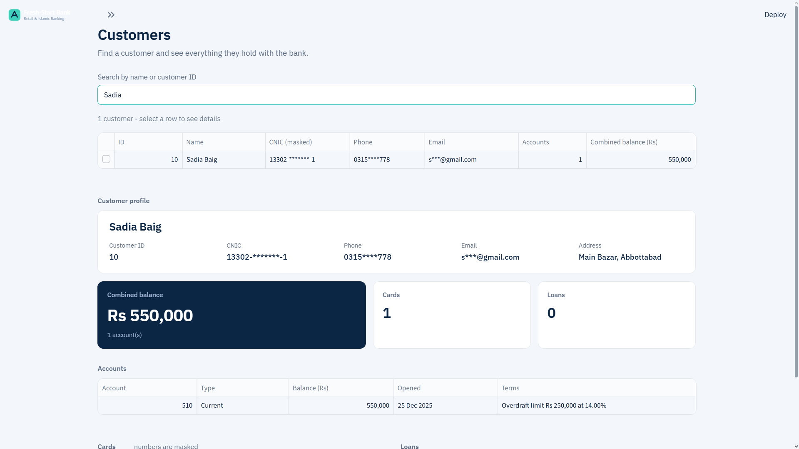
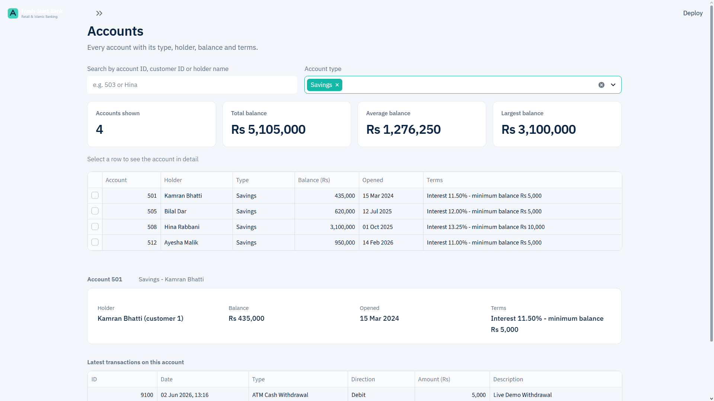
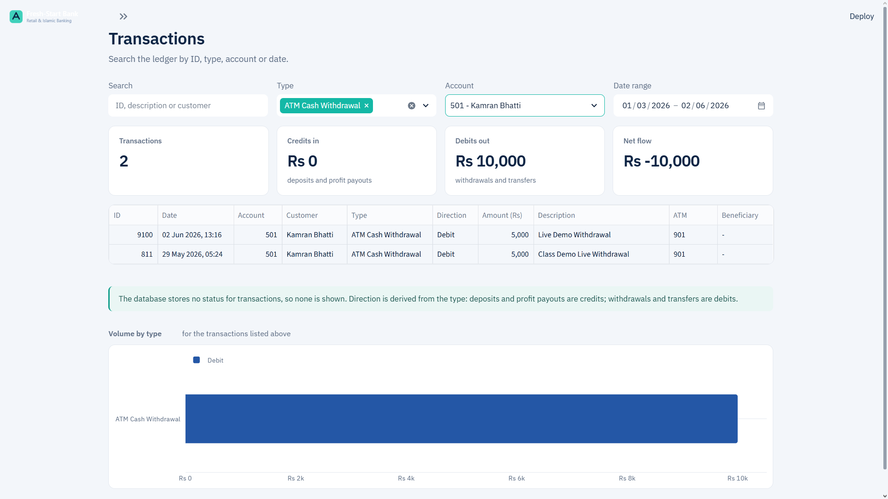
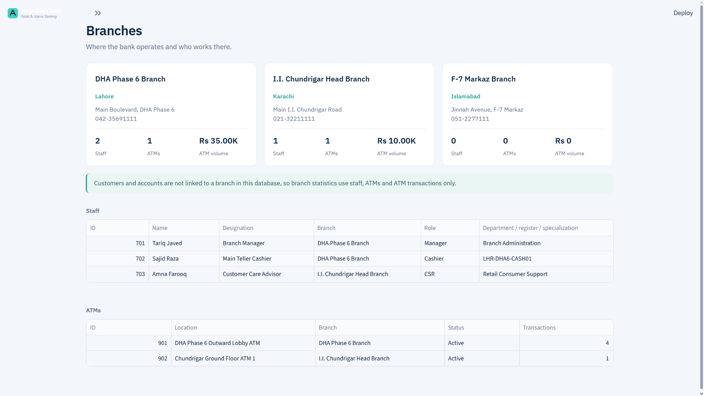
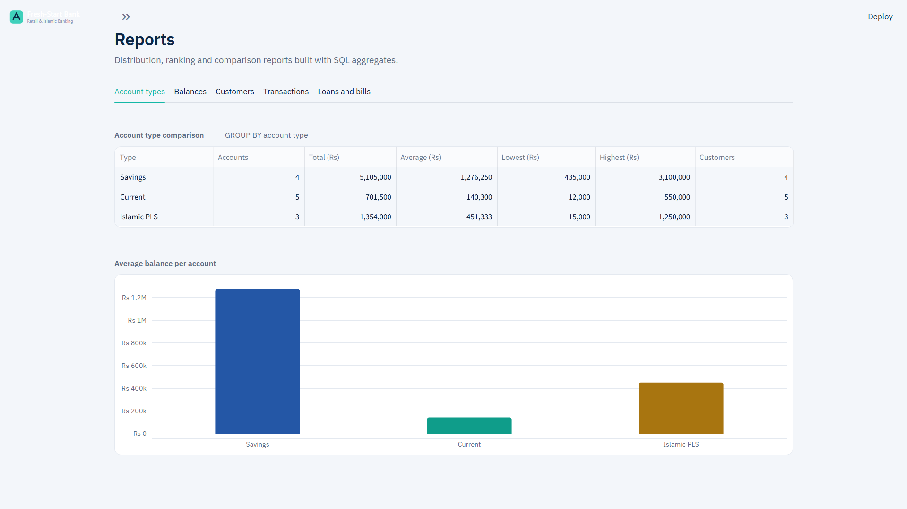
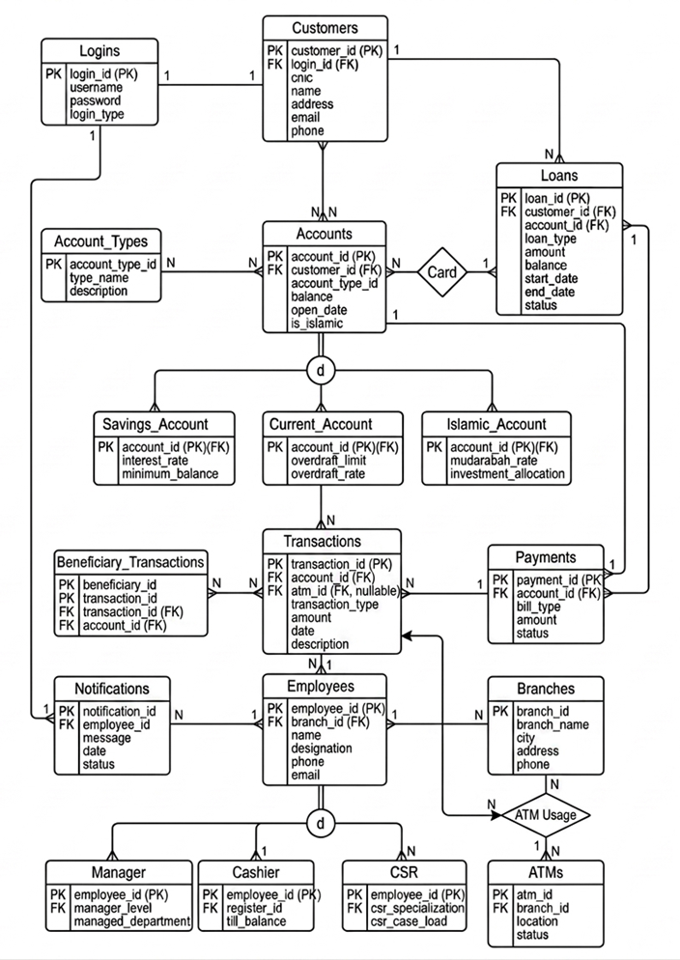

# Fresh-Start Retail & Islamic Banking Dashboard

A read-only banking administration dashboard built with **Python, Streamlit, MySQL, Pandas, and Plotly**. The application provides an interactive overview of retail and Islamic banking operations, including customers, accounts, transactions, branches, and reports.

This project was developed as an academic database project to demonstrate relational database design, SQL queries, data analysis, and dashboard development.

## Main Dashboard



## Application Screenshots

### Customers
Customer search, profile information, and associated accounts, cards, and loans.



### Accounts
Account information, account types, balances, and account-level details.



### Transactions
Transaction records, transaction types, activity trends, and filtering.



### Branches
Branch information, employee distribution, and ATM-related insights.



### Reports
Banking summaries, analytical charts, and reporting views.



## Database ER Diagram

The ER diagram illustrates the relational database structure, including tables, relationships, and foreign-key connections.



## Features

### Dashboard
- Overview of key banking metrics.
- Account and transaction summaries.
- Interactive charts and visualisations.
- Date-based filtering where supported.

### Customer Management
- Search customers.
- View customer profiles.
- Explore associated accounts, cards, and loans.
- Masked display of sensitive customer information.

### Account Management
- View account information and balances.
- Explore savings, current, and Islamic account categories.
- Filter and inspect account records.

### Transaction Monitoring
- Browse transaction records.
- Filter transaction data.
- View transaction trends and summaries.

### Branch Management
- Explore bank branches.
- View employee and ATM-related information.
- Compare branch-level activity.

### Reports
- Banking analytics and summary reports.
- Interactive visualisations.
- Filterable reporting views.

## Technology Stack

| Technology | Purpose |
|---|---|
| Python | Application logic |
| Streamlit | Dashboard interface |
| MySQL 8 | Relational database |
| mysql-connector-python | Database connectivity |
| Pandas | Data processing |
| Plotly | Interactive charts |
| python-dotenv | Environment configuration |

## Project Structure

```text
fresh-start-banking/
│
├── app.py
├── config.py
├── database.py
│
├── pages/
│   ├── 2_Customers.py
│   ├── 3_Accounts.py
│   ├── 4_Transactions.py
│   ├── 5_Branches.py
│   └── 6_Reports.py
│
├── utils/
│   ├── queries.py
│   └── helpers.py
│
├── assets/
│   └── styles.css
│
├── sql/
│   ├── schema.sql
│   ├── sample_data.sql
│   └── schema_documentation.md
│
├── docs/
│   ├── screenshots/
│   │   ├── 01-dashboard.png
│   │   ├── 02-customers.png
│   │   ├── 03-accounts.png
│   │   ├── 04-transactions.png
│   │   ├── 05-branches.png
│   │   └── 06-reports.png
│   │
│   ├── diagrams/
│   │   └── ER-Diagram.png
│   │
│   └── reports/
│       ├── Banking-Database-Project.docx
│       └── Banking-Database-Project.pdf
│
├── requirements.txt
├── .env.example
├── .gitignore
└── README.md
```

## Getting Started

### 1. Clone the Repository

```bash
git clone <repository-url>
cd fresh-start-banking
```

### 2. Create the MySQL Database

Create a MySQL database for the project:

```sql
CREATE DATABASE DB_Final_Group_Project_Working;
```

### 3. Import the Database Files

Import the schema first:

```bash
mysql -u your_username -p DB_Final_Group_Project_Working < sql/schema.sql
```

Then import the sample data:

```bash
mysql -u your_username -p DB_Final_Group_Project_Working < sql/sample_data.sql
```

### 4. Create a Python Virtual Environment

```bash
python -m venv .venv
```

Activate it:

**Windows:**
```bash
.venv\Scripts\activate
```

**Linux/macOS:**
```bash
source .venv/bin/activate
```

### 5. Install Dependencies

```bash
pip install -r requirements.txt
```

### 6. Configure Environment Variables

Copy `.env.example` to `.env` and update the database connection settings.

Example:

```env
DB_HOST=127.0.0.1
DB_PORT=3306
DB_USER=your_username
DB_PASSWORD=your_password
DB_NAME=DB_Final_Group_Project_Working
MASK_PII=true
```

Never commit your actual `.env` file or database credentials.

### 7. Run the Application

```bash
streamlit run app.py
```

Open the local URL provided by Streamlit, usually:

```text
http://localhost:8501
```

## Database Design

The project uses a relational MySQL database to represent retail and Islamic banking operations.

Its database includes entities such as:

- Customers
- Employees
- Branches
- Accounts
- Account types
- Savings accounts
- Current accounts
- Islamic accounts
- Transactions
- Cards
- Loans
- ATMs
- Payments
- Notifications

The database uses primary keys, foreign keys, constraints, and relationships to maintain data integrity.

The account structure uses a base account table with separate account-specific tables for savings, current, and Islamic accounts.

For further database details, see:

- `sql/schema_documentation.md`
- `docs/diagrams/ER-Diagram.png`

## Security and Data Handling

- Database credentials are configured through environment variables.
- User-provided query values are parameterised.
- The application is designed for read-only database access.
- Sensitive customer information is masked in the interface where applicable.
- Actual credentials, database backups, and private configuration files must not be committed to GitHub.

## Project Scope

This is an academic demonstration project focused on database design, SQL querying, and interactive banking data visualisation.

The application provides read-only administrative views. It does not perform actual banking operations, transfer funds, process payments, or modify customer records.

---

**Built with Python, Streamlit, MySQL, and Plotly.**